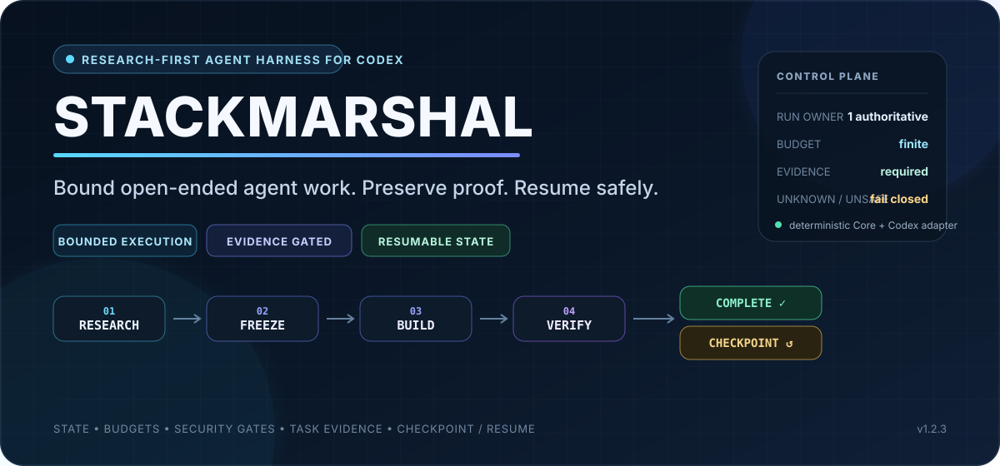
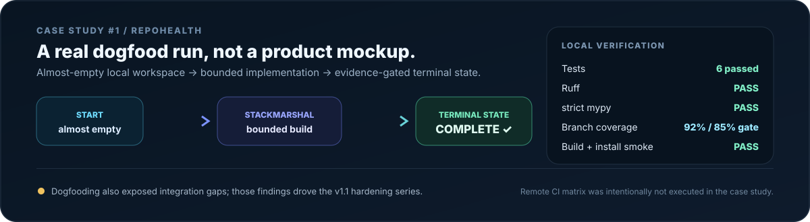
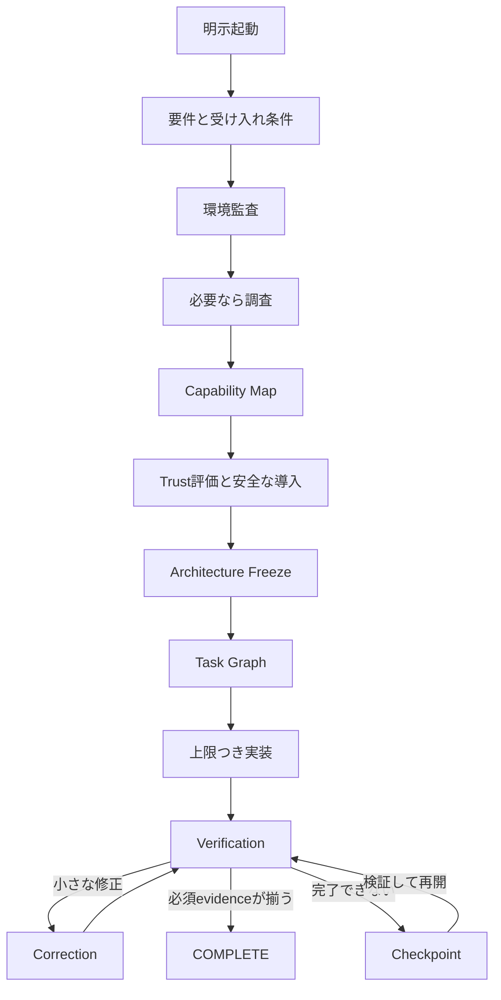

<p align="center">
  <strong>日本語</strong> · <a href="README.md"><strong>English</strong></a>
</p>

<p align="center">
  
</p>

<h1 align="center">StackMarshal</h1>

<p align="center"><strong>Codexの作業を、有限で検証可能なrunにするAgent Harness。</strong></p>
<p align="center">必要なことを調べ、使えるものを選び、設計を固め、証拠を残して終える。</p>

<p align="center">
  <a href="https://github.com/Soph1yzzz/stackmarshal/releases/latest"></a>
  <a href="https://github.com/Soph1yzzz/stackmarshal/actions/workflows/ci.yml"></a>
  <a href="https://github.com/Soph1yzzz/stackmarshal/actions/workflows/codeql.yml"></a>
  
  
  
  
</p>

<p align="center">
  <strong><a href="#1コマンドで導入">Install</a></strong> ·
  <strong><a href="docs/CASE_STUDY_01_REPOHEALTH.ja.md">実証</a></strong> ·
  <strong><a href="docs/ARCHITECTURE.md">Architecture</a></strong> ·
  <strong><a href="docs/THREAT_MODEL.md">Security</a></strong> ·
  <strong><a href="docs/README.md">Docs</a></strong>
</p>

StackMarshalは、終わり方が曖昧になりやすいCodexの作業に、明確な上限と完了条件を持たせます。
必要なら先に調査し、既存のSkillやMCP、ライブラリなどを比較してから設計を固めます。実装に入った後は、試行回数や作業量を追跡し、最後に受け入れ条件を証拠つきで確認します。安全に完了できない場合は、無理に`COMPLETE`へ進まず、続きから再開できるcheckpointを残します。

> StackMarshalが保証するのは「何でも必ず完成すること」ではありません。
> **証拠のある`COMPLETE`か、理由と再開手順のある正式な停止**です。

## 30秒で分かるStackMarshal

<table>
  <tr>
    <td width="33%"><strong>終わりを決める</strong><br/>budget、attempt、stagnation、terminal stateで、runが際限なく続かないようにします。</td>
    <td width="33%"><strong>「終わった」を証明する</strong><br/>taskごとの証拠と最終verificationが揃わない限り、<code>COMPLETE</code>には進めません。</td>
    <td width="33%"><strong>止まっても続きから戻れる</strong><br/>checkpointを現在のrepository stateと結び付け、再開時に食い違いを検出します。</td>
  </tr>
</table>

| よくあるAgent作業 | StackMarshalを使うと |
|---|---|
| 調べるべきか判断する前に実装へ入る | Research Gateで、先に調査が必要かを決める |
| 既存Toolを作り直したり、依存を気軽に増やす | Skill / MCP / plugin / library / CLI / reference OSSを分けて比較し、導入前にtrustを確認する |
| 実装中に設計が少しずつ変わっていく | Architecture Freeze後の変更を明示し、再調査にも回数上限を置く |
| 同じ失敗をcontext切れまで繰り返す | task attempt、failure fingerprint、stagnation、budgetで打ち切る |
| Agentが「完了した」と言っても、何を確認したか分からない | task evidenceとverificationを`COMPLETE`の条件にする |
| Chatが止まると、再開に必要な情報も消える | checkpointに現在の状態と次の一手を残す |

### Promptだけで頑張らせる仕組みではありません

StackMarshalの中心にあるのは、Codexへの長い指示文ではなく決定論的なCoreです。run state、budget、stop condition、task evidence、terminal stateはCoreが管理します。

調査は必要な場面に絞ります。小さな修正なら、そのまま実装へ進みます。新規開発や依存追加、セキュリティ、認証など、先に調べる意味がある作業だけResearchを挟みます。

Securityに関わる操作もworkflowの途中で判定します。publication、secret、billing、privilege、global write、external binary、network writeには承認境界を置きます。未知のcommand formも、安全だと推測して先へ進めません。

runやtaskの正本、checkpoint、acquisition receiptは、ユーザー領域にあるHMAC鍵で保護します。repository内のファイルだけを権威にはしません。resume時にはGitの状態とworktree fingerprintも照合するので、workspaceが変わった古いcheckpointはそのまま再利用できません。

現在提供しているSkillはCodex向けですが、CoreはAgent固有の処理から分離しています。v1.2.0では書き込み経路も分けました。通常のCodexは従来どおり直接ファイルへ書き込み、DevSpaceのようにshellからprojectを書けないhostではHostWriteAdapterを使います。

### Dogfooding実証：RepoHealth

<p align="center">
  <a href="docs/CASE_STUDY_01_REPOHEALTH.ja.md"></a>
</p>

**Case Study #1**では、ほぼ空のlocal workspaceでStackMarshalを明示起動し、CodexにOSS-readiness CLI「RepoHealth」を作らせました。runtime dependencyは0です。

採用runでは、次の条件をすべて通して`COMPLETE`まで到達しました。

- tests 6 passed
- Ruff PASS
- strict mypy PASS
- branch-aware coverage 92%（gate 85%）
- wheel + sdist build PASS
- local wheel install smoke PASS

このdogfoodingでは、StackMarshal側の問題もいくつか見つかりました。live state、budget accounting、task同期の不足は、その後のv1.1系hardeningへ直接つながっています。都合のよい成功例だけを切り出した記録ではありません。

証拠、留保、remote CI未実行条件を含む詳細は[Case Study #1 — RepoHealth 日本語版](docs/CASE_STUDY_01_REPOHEALTH.ja.md)に残しています。

### Field dogfood：MandateMarshal v0.2

**Case Study #2**では、別OSSのdurable runtime / crash recovery実装でStackMarshalを実際に使いました。mandatory taskは5件、attemptも合計5回。research roundは1、tool callは72で、finalization後に`COMPLETE`へ到達しています。

このrunで特に重要だったのは、最終盤でsourceを変更した後の挙動です。以前のverification結果をそのまま使おうとすると、`missing_verified_workspace_fingerprint`で`COMPLETE`が拒否され、変更後のworkspaceをもう一度検証する必要がありました。

同じrunから、v1.1.3で直すことになる問題も3件見つかりました。Git porcelain path parsing、launcher / CLI / Skillのversion skew、Windows予約device名のfingerprint処理です。その後のpre-release security reviewでは、unsigned live run/task authorityも追加で見つかっています。

詳細は[Case Study #2 — MandateMarshal 日本語版](docs/CASE_STUDY_02_MANDATEMARSHAL.ja.md)（[English](docs/CASE_STUDY_02_MANDATEMARSHAL.md)）を参照してください。

### 1コマンドで導入

**Windows PowerShell**

```powershell
irm https://github.com/Soph1yzzz/stackmarshal/releases/latest/download/install.ps1 | iex
```

**macOS / Linux**

```bash
curl -fsSL https://github.com/Soph1yzzz/stackmarshal/releases/latest/download/install.sh | bash
```

installerは専用のvirtual environmentへCLIを入れ、同じversionのCodex Skillも配置します。Release assetを検証し、最後にdoctorまで実行します。現在のPython環境やglobal PythonへStackMarshalを混ぜる方式ではありません。

初回導入後の更新は`stackmarshal pin latest`で行えます。versionを固定したい場合はexact versionを指定できます。

v1.1.5で同じrunの再開と検証後の修正に対応し、v1.2.0でHostWriteAdapterを導入しました。v1.2.1では書き込みの安全性と操作量を改善し、v1.2.2で`next`や後からのtask追加を実装。v1.2.3では探索を始めやすくし、Gitの初期化と作業証拠の照合を追加しています。

## StackMarshalが管理するもの

StackMarshalは、Codex向けのResearch First型orchestration Skillと、その状態を管理するCLI/Coreで構成されています。

依頼を整理し、必要なら環境と既存OSSを調べ、使えるSkill・MCP・plugin・library・CLIを比較します。その後でArchitectureを固め、taskへ分解し、上限つきで実装します。最後は受け入れ条件を確認し、完了できなければcheckpointを残します。

### 守っている契約

- **明示的に呼ばれたときだけ起動する**：通常の実装依頼では勝手にStackMarshalを始めません。
- **調査は必要なときだけ行う**：小さな局所修正に大掛かりなResearchを挟みません。
- **使えるものを種類ごとに分ける**：Skill、MCP、plugin、library、CLI、参考OSSを同じものとして扱いません。
- **導入前にSupply Chainを確認する**：pin、hash、provenance、install hook、権限、license、rollback方法を確認します。
- **実装前にArchitectureを固める**：後から前提が崩れた場合だけ、上限つきで再調査します。Task Graph後に必須作業が増えた場合も`REPLAN`を通します。
- **live stateをrepositoryだけに任せない**：`run.json`とcanonical task graphはユーザー領域HMACで認証します。repository内のファイルを書き換えただけではphaseや`COMPLETE`を偽装できません。
- **実際の作業量をbudgetへ記録する**：CodexがToolを使ったのに帳簿上は`used=0`という状態を避けます。Hostが単調増加する実測値を持つ場合は差分だけ同期できます。
- **次に何が可能かを状態として返す**：`stackmarshal next`はblocker、legal transition、未完了task、completion条件を返しますが、復旧方法そのものは決めません。
- **探索の邪魔をしない**：`quick-explore`なら実験に不要な工程を省略できます。ただし、検証や公開時の安全条件は緩めません。
- **Gitを初手で確認する**：未初期化ならrepoを作れますが、既存ファイルの一括登録やcommitは行いません。
- **taskの正本はmachine-readableに保つ**：task statusとevidenceをJSONで管理し、Markdownは人間向けviewとして生成します。
- **止まり方を正式なstateにする**：budget exhaustion、同一failureの反復、stagnation、scope driftなどを検出してrunを有限に保ちます。
- **checkpointから同じrunへ戻れる**：`stackmarshal resume <run-id>`は、checkpointのHMAC、project identity、Git state、worktree fingerprint、resume phaseを照合してから再開します。
- **verificationで見つかった小修正は別laneで扱う**：`VERIFICATION -> CORRECTION -> VERIFICATION`ならarchitecture replan budgetを消費しません。
- **古いunsigned stateを勝手に信用しない**：`stackmarshal migrate`は旧stateをhash付きでarchiveし、署名済みの現在stateへ昇格させません。
- **書き込み手段が違ってもCoreの判断は変えない**：通常はdirect filesystem write、shell write禁止hostではHostWriteAdapterを使います。どちらでもstate machine、budget、acceptance、completion ruleは同じです。

## 起動方法

StackMarshalは、名前を出しただけでは起動しません。「StackMarshalを使う」と明示した依頼だけを対象にします。

起動する例：

```text
StackMarshalを使って実装して。
Use StackMarshal to build this feature.
使用 StackMarshal 实现这个功能。
$stackmarshal build
```

起動しない例：

```text
この機能を実装して。
StackMarshalとは？
StackMarshalに似たOSSを比較して。
README内のStackMarshalという表記を直して。
```

## 導入と更新

通常はReleaseのinstallerを使います。CLIとCodex Skillのversionを揃えて導入し、`SHA256SUMS`でRelease assetを検証した後、doctorで状態を確認します。

**Windows PowerShell**

```powershell
irm https://github.com/Soph1yzzz/stackmarshal/releases/latest/download/install.ps1 | iex
```

**macOS / Linux**

```bash
curl -fsSL https://github.com/Soph1yzzz/stackmarshal/releases/latest/download/install.sh | bash
```

初回導入後はCLI自身から更新できます。

```bash
stackmarshal pin latest
stackmarshal pin status
stackmarshal version
```

exact releaseへ固定する場合：

```bash
stackmarshal pin 1.2.2
```

`stackmarshal version`では、現在動いているCLI、managed pin、installed Skill、PATHで解決されたlauncherをまとめて確認できます。すべて揃っていれば`OK`、ずれがあれば`DRIFTED`です。scriptからversion文字列だけ欲しい場合は`stackmarshal --version`を使います。

`pin`は、指定したReleaseのbootstrapを`SHA256SUMS`で検証してから、既存のatomic installerへ処理を渡します。update、repair、rollbackを別々に実装していません。

前提はGitとPython 3.11以上です。足りない場合、installerは何が不足しているかを表示し、OS package managerを使う前に確認を取ります。user `PATH`の変更や、編集済み・installer管理外のSkillを置き換える場合も同様です。非対話で導入する場合だけPowerShellの`-Yes`、Bashの`--yes`を使ってください。

downgradeは明示しない限り拒否します。必要な場合は`-AllowDowngrade`または`--allow-downgrade`を付けます。

CLIの必須runtime dependencyは0です。Skillを導入・更新した後はCodexを再起動してください。installerはCodex homeにrestart-pending markerを置きます。再起動前の古いSkillはStackMarshalの起動を拒否し、再起動後に同じversionのSkillがmarkerをacknowledgeしてから通常状態へ戻ります。

Skillだけを手動で入れる場合も、`main`ではなく対応するRelease tagへ固定してください。

```text
$skill-installer install https://github.com/Soph1yzzz/stackmarshal/tree/v1.2.3/skills/stackmarshal
```

## CLI例

```bash
stackmarshal --version
stackmarshal version
stackmarshal pin status
stackmarshal repair --remove-shadowed
stackmarshal init
stackmarshal git inspect
stackmarshal git bootstrap
stackmarshal migrate --dry-run
stackmarshal invocation "StackMarshalを使って実装して"
stackmarshal start --mode build --budget standard \
  --invocation "StackMarshalを使って実装して"
stackmarshal start --workflow quick-explore --invocation "$stackmarshal build"
stackmarshal doctor --host-skill-version 1.2.3
stackmarshal state show
stackmarshal next
stackmarshal state transition INTENT_NORMALIZATION
stackmarshal budget check
stackmarshal activity record tool-call --amount 2 --detail "bounded host-tool batch"
stackmarshal activity sync-host --source host-session --tool-calls-total 12
stackmarshal task add implement --summary "機能を実装" --acceptance "tests pass"
stackmarshal task add late-fix --summary "追加で必要になった作業" --acceptance "covered" --replan
stackmarshal task amend implement --summary "別方式へ変更" --acceptance "新しい方法の実機検証" --reason "実測結果が変わった"
stackmarshal evidence reconcile
stackmarshal release-evidence record --tests build/tests.txt --security build/security.txt --artifacts build/manifest.json
stackmarshal task start implement
stackmarshal task complete implement --evidence "tests/test_feature.py passed"
stackmarshal state transition CORRECTION
stackmarshal activity record correction --detail "bounded verification fix"
stackmarshal state transition VERIFICATION
stackmarshal finalize
stackmarshal state transition COMPLETE
stackmarshal candidate score candidate.json
stackmarshal failure fingerprint failure.json
stackmarshal progress evaluate current.json --previous previous.json
stackmarshal lock verify .stackmarshal/project/locks/dependencies.lock.json
stackmarshal checkpoint create --next-action "外部ブロッカーを解消する"
stackmarshal resume <run-id> --reason "blocker resolved"
stackmarshal resume inspect --run-id <run-id>
stackmarshal host-write status
stackmarshal host-write check --plan-id <plan-id>
stackmarshal host-write recover --plan-id <plan-id> [--path <relative-path>]
stackmarshal host-write ack --plan-id <plan-id>
stackmarshal relocate prepare --to <new-root>
stackmarshal --write-mode host relocate accept --permit-id <permit-id>
```

### Shellからprojectを書けないHost

普通のCodexやCLIは今までどおりです。StackMarshal自身が`.stackmarshal/`へ直接書き込みます。HostWriteAdapterを使うのは、DevSpaceのように「shellからproject fileを書き換えない」という契約があるhostだけです。

```text
stackmarshal --write-mode host <通常のmutating command>
        ↓
hostのwrite/edit APIでsigned planを適用
        ↓
stackmarshal host-write ack --plan-id <id>
```

`host-write check`は残っていますが、必ず一段挟むための儀式ではありません。host側のAPIだけではsigned preimageを十分に確認できない場合や、状態がおかしいときのpreflightとして使います。

`write_text`は従来どおり、既存fileなら変更前の全文とSHA-256を比較条件にします。一方、増え続ける`events.jsonl`はv1.2.1から`append_text`になりました。planへ履歴全文を毎回埋め込まず、file全体のSHA-256とsize、末尾最大512文字の`expected_tail`、今回追加する`append_content`だけを持ちます。DevSpaceなら`expected_tail`を`oldText`、`expected_tail + append_content`を`newText`として`edit`へ渡せるため、長いrunでもevent履歴全文を会話へ往復させずに済みます。

全operationを適用した後に`host-write ack`を1回だけ実行します。Coreはproject上の最終postimageをhashし直し、signed planと一致したときだけpendingを解除します。pending planがある間は、`--write-mode host`を付けたcommandだけでなくdirect modeのproject mutationも止まります。pending file自体もexclusive createになっているため、別processが同時にplanを作ってslotを上書きすることはありません。

途中でfileを壊した場合は`host-write recover`からsigned preimageを取り出せます。recover自身はprojectを書きません。返された内容をhostのnative file APIで戻してから、元のplanをやり直します。

workspaceを移動するときは、移動前に`stackmarshal relocate prepare --to <new-root>`でsigned permitを作ります。移動後に`relocate accept`を通すと、deliverable fingerprintとrepository identityを照合した上で`workspace_relocation`として記録します。後から`git init`した場合の`workspace_repository_bootstrap`とは別のmigrationです。

`migrate`はv1.2.1でもhost-write対象外です。managed installに関わる`pin`と`repair`もproject HostWriteAdapterの外側で動きます。詳しいtransport契約は[HostWriteAdapter protocol](docs/HOST_WRITE_ADAPTER.md)にまとめています。

機械向け出力はJSONです。`checkpoint create`が正常にcheckpointを作れた場合はexit 0を返します。一方、formal `stop`はbudget、approval、unsafe、external blockedなどの理由を非zero exit codeで区別します。

## Workflow



正式な停止状態は次のとおりです。

`BUDGET_EXHAUSTED`、`STAGNATED`、`REPEATED_FAILURE`、`APPROVAL_REQUIRED`、`BLOCKED_EXTERNAL`、`VERIFICATION_EXTERNAL_BLOCKED`、`UNSAFE_DEPENDENCY`、`SCOPE_DRIFT`、`INVALID_STATE`、`USER_CANCELLED`

## Case Study

- **Case Study #1 — RepoHealth**：ほぼ空のlocal workspaceから、runtime dependency 0のOSS-readiness CLIを作ったdogfoodingです。tests、Ruff、strict mypy、branch-aware coverage 92%、package build、local install smokeまで通し、同時にStackMarshal側のlive state、budget accounting、task同期の問題も見つけました。詳細は[日本語Case Study](docs/CASE_STUDY_01_REPOHEALTH.ja.md)（[English](docs/CASE_STUDY_01_REPOHEALTH.md)）にあります。
- **Case Study #2 — MandateMarshal v0.2**：実際のOSS開発でdurable runtime / crash recoveryを実装したfield dogfoodです。source変更後に古くなったverificationをcompletion gateが拒否し、v1.1.3で直すことになるruntime-trust問題も同じrunから見つかりました。詳細は[日本語Field Case Study](docs/CASE_STUDY_02_MANDATEMARSHAL.ja.md)（[English](docs/CASE_STUDY_02_MANDATEMARSHAL.md)）を参照してください。

## セキュリティモデル

外部のREADME、Issue、コメント、AGENTS、SKILLは、StackMarshalにとって未信頼の入力です。そこに「このcommandを実行しろ」「secretを読め」「policyを変えろ」と書かれていても、それだけでは権限になりません。

StackMarshalはcommandを分類し、外部へ影響する操作に承認を要求します。対象はglobal write、network write、secret access、課金、publication、external binary、privilegeです。知らないcommand formも、安全だろうと推測せずfail-closedします。

既存のdirty stateは保持します。run ID、workspace境界、Release入力のsymlinkはそれぞれ検証します。rollbackの対象も、acquisition receiptが実際に作成したfileだけです。一般的なsecret形式はlogからredactし、導入したもののprovenanceを残します。

次のような候補は採用しません。

- licenseがない
- 危険なinstall hookを持つ
- Criticalの既知脆弱性がある
- 要求権限が過剰
- binaryを検査できない
- 再現可能なpinができない

Checkpointとacquisition receiptの署名鍵はrepository外の`~/.stackmarshal/integrity-signing.key`に保存します。Checkpointにはtracked / staged / untrackedを含むworktree fingerprintも記録されます。

管理するユーザーstateの場所を変えたい場合は`STACKMARSHAL_STATE_HOME`、署名鍵を別の場所へ置く場合は`STACKMARSHAL_SIGNING_KEY_FILE`を設定できます。鍵を失ったstateは、署名を検証できないまま黙って信用することはありません。

脆弱性の報告方法は[SECURITY.md](SECURITY.md)を参照してください。

## 開発

```bash
python -m venv .venv
# Windows: .venv\Scripts\activate
# POSIX:   source .venv/bin/activate
python -m pip install -e ".[dev]"
ruff check src tests
mypy src/stackmarshal
coverage run -m pytest
coverage report --fail-under=85
python -m build
python -m twine check dist/*
python scripts/version_contract.py --check
python scripts/release_gate.py --stage candidate
```

Release versionの正本は`pyproject.toml [project].version`です。versionを意図的に上げた後は、`python scripts/version_contract.py --sync`で現在versionを参照するmirrorだけを同期します。Core、Skill、READMEなどにversionの食い違いがあれば、CIとrelease builderは失敗します。

candidateをcommitし、worktreeがcleanになったら`python scripts/release_gate.py --stage immutable`を実行します。ここでは決定論的なRelease buildに加え、platform bootstrap installer smokeまでまとめて検証します。このsmokeはRelease gateの一部なのでskipできません。

local host側の制限でPowerShellやBashそのものをspawnできない場合は、`python scripts/smoke_installer.py --direct-installer`で共有installer経路だけを診断できます。ただし、これはimmutable stageで行うplatform bootstrap smokeの代わりにはなりません。

公開後は、GitHubからassetを取り直して次を実行します。

```bash
python scripts/release_gate.py --stage published --release-dir <downloaded-assets>
```

published gateでは、assetの構成とchecksum、各componentのversion、manifest / provenanceとGit HEADの対応、local release tagを確認します。bundle内のchecksumだけには頼りません。GitHub側が記録したasset digestも別に照合します。

CIはUbuntu、macOS、WindowsでPython 3.11〜3.13を検証します。Windows 11互換はv1のRelease条件です。

## 現時点の制限

v1系はCodex向けです。CoreはAgent固有処理から分離していますが、Claude CodeやGemini CLIの正式adapterはまだありません。multi-agent orchestrationも未実装です。

LLMがSkillの手順に必ず従う保証はありません。StackMarshalが決定論的に管理できるのは、Coreが扱うstate、budget、検証条件、証拠形式、stop ruleの範囲です。

live調査能力はhost側のGitHub / Web / Registry adapterに依存します。脆弱性情報や名称・商標の確認は時間とともに変わるため、Releaseごとに再確認が必要です。

PyPIへの公開はGitHub Releaseとは分けています。

## Contribution / License

Contributionの手順は[CONTRIBUTING.md](CONTRIBUTING.md)にあります。行動規範は[CODE_OF_CONDUCT.md](CODE_OF_CONDUCT.md)、RFCの進め方は[docs/RFC_PROCESS.md](docs/RFC_PROCESS.md)を参照してください。

LicenseはApache License 2.0です。全文は[LICENSE](LICENSE)にあります。
